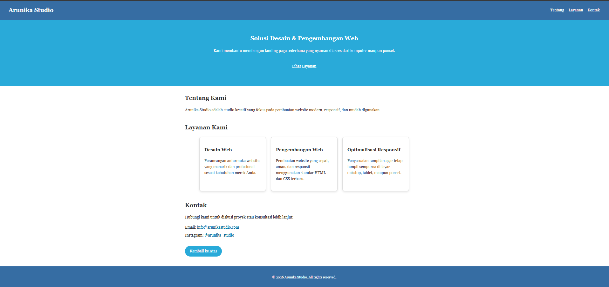
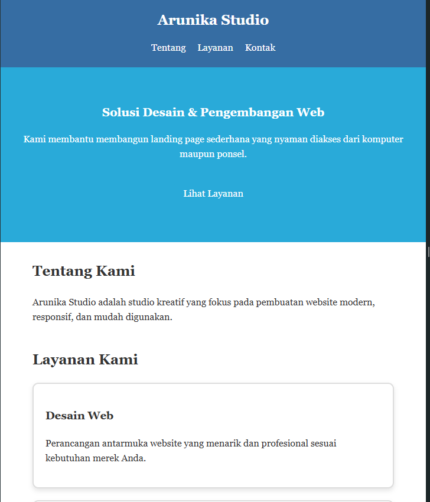

# Mini Portofolio - Arunika Studio

Landing page responsif sederhana untuk **Arunika Studio** yang dibangun menggunakan HTML5 dan CSS3 untuk tampilan dekstop dan ponsel[cite: 6].

---

## Fitur & Implementasi Kode

1. **Penerapan Box Model**
   * Pengaturan `padding`, `margin`, `border`, dan `width` pada setiap elemen.
   * Menggunakan `box-sizing: border-box;` agar ukuran elemen presisi.

2. **2 Class Reusable**
   * `.card`: Dipakai berulang kali untuk 3 kartu layanan.
   * `.button`: Dipakai berulang kali untuk gaya tombol *"Lihat Layanan"* dan *"Kembali ke Atas"*.

3. **Sticky Header & Flexbox**
   * `position: sticky; top: 0; z-index: 1000;` agar header menempel di atas saat di-scroll[cite: 2].
   * `display: flex; justify-content: space-between;` untuk menata judul di kiri dan navigasi di kanan.

4. **Efek Interaktif & Hover**
   * **Card:** Terangkat naik halus (`transform: translateY(-5px);`) dan memiliki bayangan (`box-shadow: 0 4px 8px rgba(0,0,0,0.1)`)[cite: 3].
   * **Button:** Bentuk lonjong/kapsul (`border-radius: 25px;`) dan berubah warna hijau tua (`#2e7d32`) saat di-hover[cite: 4].

5. **Responsif (Media Query)**
   * Menggunakan `@media (max-width: 768px)`[cite: 6].
   * Susunan header dan 3 kartu layanan otomatis berubah dari horizontal menjadi 1 kolom vertikal di layar HP[cite: 6].

---

## Masalah & Solusi

* **Masalah Utama:** Kode CSS tidak boleh tersebar (*inline styling*) dan tata letak 3 kartu layanan harus beradaptasi menjadi 1 kolom pada layar kecil/HP.
* **Solusi:** 
  1. Seluruh instruksi gaya dipisahkan ke file eksternal `style.css`.
  2. Menggunakan `display: flex` pada pembungkus `.card-wrapper` yang dipadukan dengan `@media (max-width: 768px)` untuk mengubah `flex-direction` menjadi `column` pada layar HP.

  ## Tampilan Website & Mobile

  
  