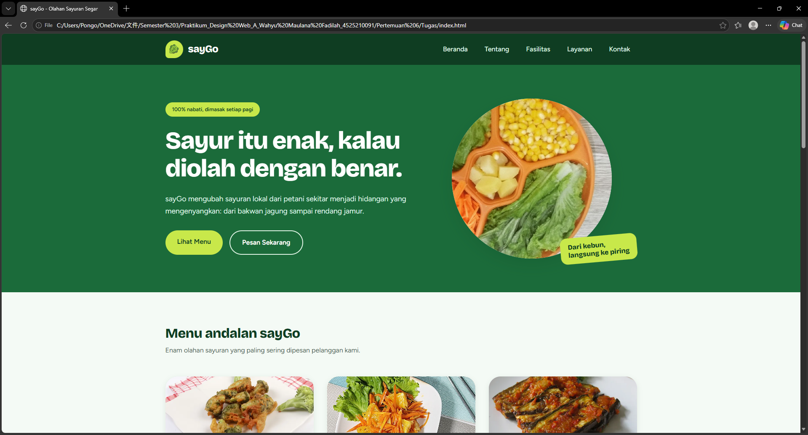

# sayGo - Mockup Dashboard Profile Restoran

Mockup halaman web profil restoran **sayGo**, restoran yang menyajikan olahan sayuran.

## Struktur Halaman

| Bagian | Tag / class | Isi |
| --- | --- | --- |
| Navbar | `<nav>` | Logo placeholder dan nama sayGo di kiri, menu horizontal di kanan (Beranda, Tentang, Fasilitas, Layanan, Kontak) |
| Head Banner | `<section id="beranda" class="head-banner">` | Highlight utama restoran: headline, deskripsi singkat, dua tombol, dan ilustrasi mangkuk sayuran |
| Area Konten Utama | `<section class="content">` | Enam menu andalan dalam bentuk kartu |
| Fasilitas | `<section id="fasilitas">` | Kartu fasilitas restoran |
| Layanan | `<section id="layanan">` | Daftar layanan yang tersedia |
| Footer | `<footer>` | Alamat, telepon, email, jam buka, dan hak cipta |

## Isi Tiap Bagian

**Menu andalan:** Brokoli Crispy Saus Lemon, Salad Wortel Jeruk, Terong Balado Bakar, Bakwan Jagung Sayur, Rendang Jamur Tiram, dan Gado-Gado sayGo. Setiap kartu punya label (Vegan, Baru, atau Pedas), deskripsi, dan harga.

**Fasilitas:** Taman Kebun Mini (kartu besar), Open Kitchen, Wi-Fi Cepat, Ruang Keluarga, dan Parkir Luas.

**Layanan:** Makan di Tempat, Bawa Pulang, Antar ke Rumah, serta Katering dan Pesanan Besar.

Nama menu, harga, alamat, dan nomor telepon adalah data contoh.

 ## Tampilan Website & Mobile

  
  
  