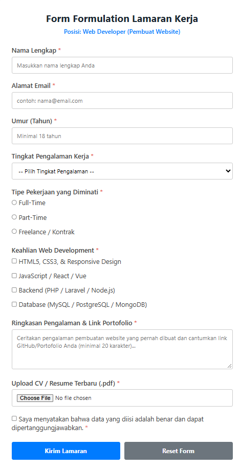
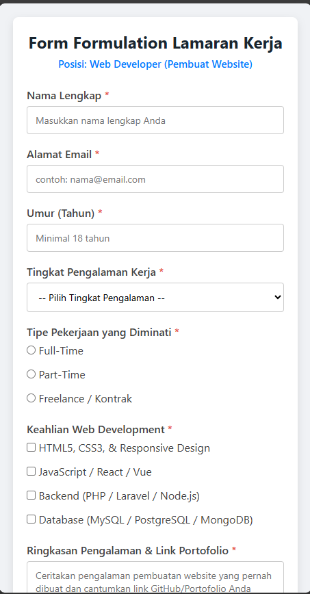

# Laporan Praktikum Pertemuan 7: Form Lamaran Kerja (Web Developer)

## 1. Deskripsi Tugas
Tugas ini mengimplementasikan form interaktif untuk **Lamaran Kerja posisi Pembuat Website (Web Developer)** menggunakan HTML5 dan CSS, serta dilengkapi dengan pengujian validasi client-side dan pembahasan pentingnya validasi server-side.

---

## 2. Kontrol Input yang Digunakan
Sesuai ketentuan praktikum, kontrol input yang diterapkan mencakup:
1. **Radio Button (`<input type="radio">`)**: Memilih salah satu opsi tipe pekerjaan (Full-Time, Part-Time, atau Freelance).
2. **Checkbox (`<input type="checkbox">`)**: Memilih satu atau beberapa keahlian/skill pembuatan website yang dimiliki pelamar, serta konfirmasi kebenaran data.
3. **Select Box (`<select>`)**: Memilih tingkat pengalaman kerja dari menu drop-down (Fresh Graduate, Junior, Middle, Senior).
4. **Textarea (`<textarea>`)**: Mengisikan ringkasan pengalaman proyek pembuatan website dan tautan portofolio/GitHub.
5. **Upload File (`<input type="file">`)**: Fasilitas unggah berkas CV/Resume dalam format PDF.

---

## 3. Aturan Validasi Client-Side yang Diterapkan
Form memiliki 5 aturan validasi utama di sisi client:
1. **Field Wajib Diisi (`required`)**: Mengunci seluruh kolom utama agar tidak boleh dikirim dalam keadaan kosong.
2. **Format Email Valid (`type="email"`)**: Memastikan format email pelamar memiliki struktur alamat email yang tepat (`@` dan domain).
3. **Batasan Umur Kerja (`min="18"` & `max="60"`)**: Memastikan usia pelamar memenuhi syarat kerja (18 hingga 60 tahun).
4. **Panjang Minimal Teks (`minlength="20"`)**: Deskripsi pengalaman pada textarea harus berisi minimal 20 karakter agar informasi memadai.
5. **Pembatasan Format Berkas (`accept=".pdf"`)**: Membatasi unggahan file CV agar hanya menerima dokumen berformat `.pdf`.

    
  
    