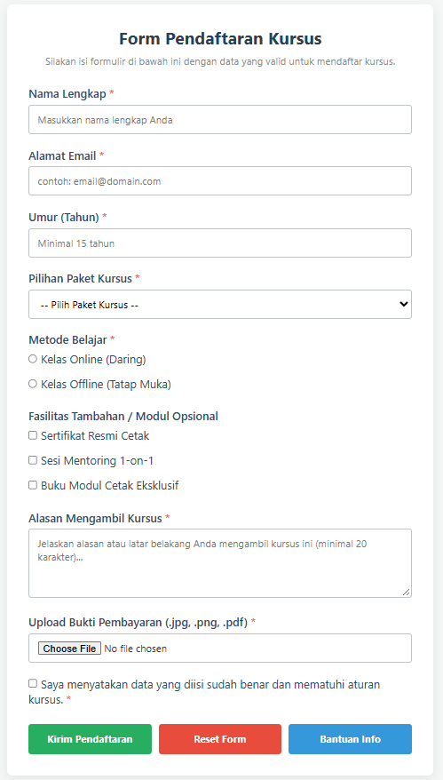
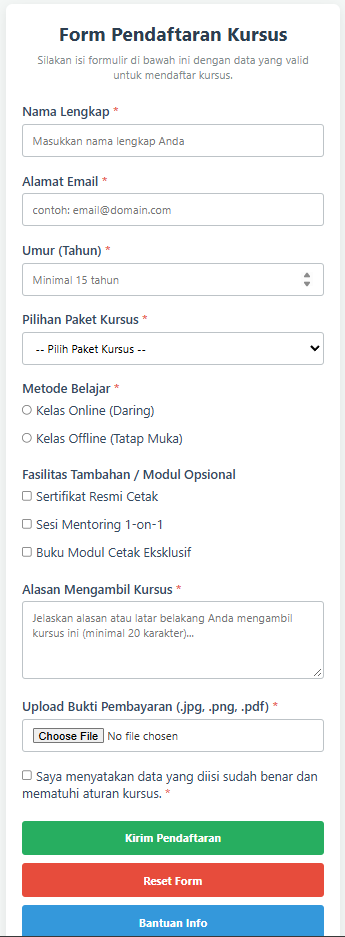

# Laporan Praktikum Pertemuan 8: Form Pendaftaran Kursus

## 1. Deskripsi Tugas
Tugas praktikum ini bertujuan untuk merancang antarmuka form pendaftaran kursus menggunakan HTML5 dan CSS lanjutan, menerapkan elemen pilihan kontrol (*radio, checkbox, select*), *textarea*, upload bukti pembayaran, pengujian 3 jenis tombol, serta menyusun skenario *test case* validasi.

---

## 2. Komponen Elemen Form yang Digunakan
HTML form ini mencakup:
1. **Radio Button (`type="radio"`)**: Menentukan metode kelas kursus (Online atau Offline).
2. **Checkbox (`type="checkbox"`)**: Memilih fasilitas tambahan opsional serta persetujuan syarat ketentuan.
3. **Select Box (`<select>`)**: Menu drop-down untuk memilih paket kursus yang tersedia.
4. **Textarea (`<textarea>`)**: Mengakomodasi isian alasan mengambil kursus secara multi-baris.
5. **Upload File (`type="file"`)**: Wadah untuk mengunggah berkas bukti transfer/pembayaran.
6. **3 Jenis Tombol**:
   - `type="submit"`: Tombol utama untuk mengirimkan data formulir.
   - `type="reset"`: Mengembalikan isian form ke nilai awal.
   - `type="button"`: Tombol netral interaktif (pemberian info bantuan via JavaScript).

---

## 3. Aturan Validasi Sisi Klien (Client-Side Validation)
Form ini menerapkan **5 aturan validasi**:
1. **`required`**: Mencegah pengiriman form apabila field wajib masih kosong.
2. **`type="email"`**: Memastikan format email valid (harus mengandung karakter `@`).
3. **`min="15"` & `max="50"`**: Batasan rentang usia peserta kursus (antara 15 sampai 50 tahun).
4. **`minlength="20"`**: Membatasi panjang teks pada bagian alasan minimal 20 karakter.
5. **`accept=".jpg,.jpeg,.png,.pdf"`**: Membatasi format ekstensi file bukti pembayaran yang diizinkan.

---

## 4. Tabel Test Case Validasi

| No | Field Input | Input Uji Skenario Salah | Hasil yang Diharapkan | Hasil Aktual |
|---|---|---|---|---|
| 1 | Alamat Email | `userdomain.com` (tanpa simbol `@`) | Browser menolak pengiriman dan memunculkan pop-up peringatan format email tidak lengkap. | Sesuai (Peringatan validasi email browser muncul). |
| 2 | Umur (Tahun) | `12` | Browser memblokir pengiriman karena nilai di bawah batas minimum (`min="15"`). | Sesuai (Form tidak terkirim dan muncul instruksi batas angka). |
| 3 | Alasan Mengambil Kursus | `Ingin belajar web` (17 karakter) | Browser menolak karena kurang dari panjang minimum 20 karakter. | Sesuai (Pesan error karakter minimal ditampilkan). |
| 4 | Paket Kursus | `-- Pilih Paket Kursus --` (kosong) | Browser menahan pengiriman karena opsi select wajib dipilih. | Sesuai (Pesan peringatan agar memilih opsi muncul). |
| 5 | Bukti Pembayaran | Mengunggah file berformat `.zip` / `.exe` | Dialog sistem menolak/menyembunyikan file non-kompatibel atau browser memblokir ekstensi di luar filter `accept`. | Sesuai (File terlarang tidak terpilih/ditolak browser). |

---

## 5. Validasi yang Tetap Wajib Dilakukan di Server (Server-Side Validation)
Meskipun validasi *client-side* di browser sudah berjalan dengan baik untuk meningkatkan *user experience*, **validasi di sisi server (seperti PHP/Node.js) tetap wajib dilakukan** karena:
1. **Bypass Validasi Klien**: Atribut HTML5 seperti `required` atau `minlength` sangat mudah dihapus atau dimodifikasi oleh pengguna menggunakan *Inspect Element* (Developer Tools). Penyerang juga bisa langsung mengirimkan request HTTP mentah via Postman.
2. **Keamanan & Verifikasi File Upload**: Atribut `accept` di browser dapat ditembus. Server wajib memeriksa ekstensi asli, tipe MIME yang sah, serta membatasi ukuran berkas (*file size limit*) untuk mencegah serangan file berbahaya atau *Denial of Service* (DoS).
3. **Pemeriksaan Basis Data (Business Logic)**: Pengecekan seperti kuota kelas yang tersisa atau validasi apakah email sudah terdaftar sebelumnya hanya dapat divalidasi dengan mengecek database di sisi server.

---

## 6. Penjelasan Perubahan, Masalah, dan Solusi
* **Masalah**: Pengguna sering kebingungan ketika tombol *reset* tidak sengaja tertekan karena posisinya bersebelahan dengan tombol *submit*, sehingga seluruh data yang sudah diketik terhapus.
* **Solusi**: Menambahkan tombol ketiga berupa tombol netral (`type="button"`) untuk fungsi bantuan serta memberikan jarak dan warna tombol yang jelas (`hijau` untuk submit, `merah` untuk reset, `biru` untuk info) agar fungsinya mudah dibedakan.
* **Masalah**: Tumpang tindih tata letak tombol pada layar perangkat seluler yang sempit.
* **Solusi**: Menerapkan CSS Media Query (`@media (max-width: 480px)`) agar tombol berubah menjadi susunan vertikal penuh ke bawah secara rapi.
***Pembatasan Format Berkas (`accept=".pdf"`)**: Membatasi unggahan file CV agar hanya menerima dokumen berformat `.pdf`.

    
  
    