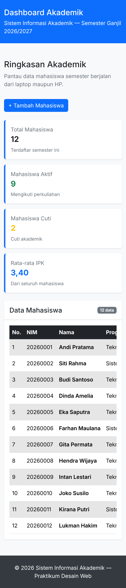
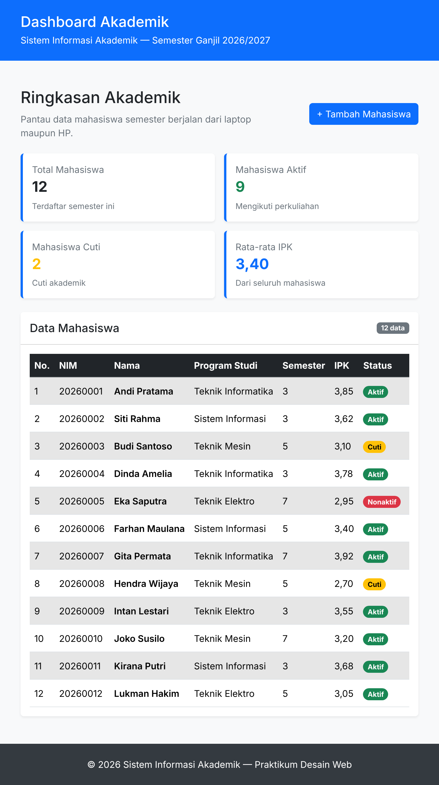
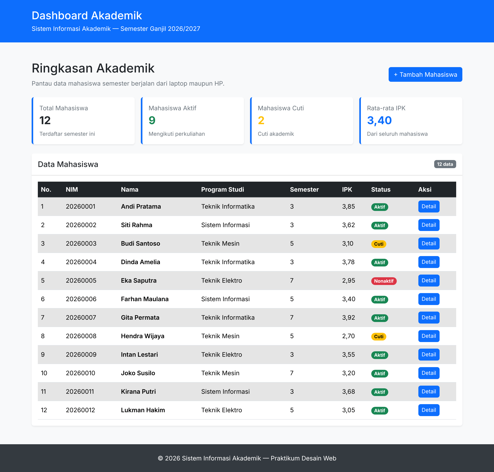

# Laporan Praktikum Pertemuan 9: Dashboard Akademik dengan Bootstrap 5

## Deskripsi Tugas
Tugas praktikum ini bertujuan untuk membuat halaman **dashboard akademik** menggunakan **Bootstrap 5 yang dipasang melalui CDN**.

---

## Komponen dan Class Bootstrap yang Digunakan
1. **Bootstrap 5.3.8 via CDN**: CSS dipanggil di `<head>`, JavaScript (`bootstrap.bundle.min.js`) dipanggil di bagian bawah `<body>`, dan `css/style.css` dipanggil **setelah** Bootstrap agar bisa menimpa tampilan bawaan.
2. **Grid System**: `container`, `row`, `col-12 col-md-6 col-lg-3`, dan `g-3` (jarak antarkolom).
3. **Card**: `card`, `card-body`, `card-header` untuk 4 kartu statistik dan pembungkus tabel.
4. **Tabel**: `table`, `table-striped`, `table-hover`, `table-responsive`, `table-dark` (header tabel).
5. **Utility Classes** (lebih dari 3): `bg-primary`, `bg-light`, `bg-dark`, `text-white`, `text-secondary`, `text-success`, `text-warning`, `text-center`, `text-md-end`, `py-4`, `my-5`, `mb-4`, `mt-3`, `fw-bold`, `fw-semibold`, `shadow-sm`, `d-flex`, `justify-content-between`, `align-items-center`.
6. **Badge**: `badge text-bg-success` (Aktif), `text-bg-warning` (Cuti), `text-bg-danger` (Nonaktif), serta `rounded-pill`.
7. **Button**: `btn btn-primary` untuk "+ Tambah Mahasiswa" dan `btn btn-sm btn-primary` untuk tombol "Detail" pada tiap baris.

---

## Hasil Tampilan (Screenshot)
Perubahan layout pada tiga ukuran layar:

### HP (375px) — 1 kolom

### Tablet (768px) — 2 kolom

### Laptop (1280px) — 4 kolom

---

## 6. Penjelasan Perubahan, Masalah, dan Solusi
* **Masalah**: Kartu statistik yang tersusun 4 kolom akan terlalu sempit dan terpotong jika ditampilkan di layar HP.
* **Solusi**: Menggunakan kombinasi class `col-12 col-md-6 col-lg-3` sehingga kartu otomatis menjadi 1 kolom di HP, 2 kolom di tablet, dan 4 kolom di laptop.
* **Masalah**: Tabel dengan 8 kolom tidak muat di layar HP sehingga membuat seluruh halaman bisa digeser ke samping.
* **Solusi**: Membungkus tabel dengan `table-responsive` agar hanya tabelnya yang bisa digeser horizontal, dan menambahkan `white-space: nowrap` pada `style.css` supaya teks sel tidak turun baris dan tabel tetap rapi.
* **Masalah**: Baris tabel yang banyak (12 baris) sulit dibaca dan sulit dibedakan satu sama lain.
* **Solusi**: Menerapkan `table-striped` (warna baris selang-seling) dan `table-hover` (baris menyala saat kursor di atasnya), serta badge berwarna untuk status (hijau = Aktif, kuning = Cuti, merah = Nonaktif).
* **Masalah**: Kartu statistik tampak datar dan kurang menonjol dari latar halaman.
* **Solusi**: Menambahkan `shadow-sm` dari Bootstrap, lalu garis aksen biru di sisi kiri dan efek naik saat *hover* pada `style.css` (`.stat-card`).

---